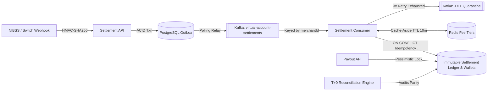

# FinTech Virtual Account Settlement & T+0 Reconciliation Engine

A fault-tolerant, event-driven payment settlement and immutable append-only settlement ledger microservice built with **Java 21**, **Spring Boot**, **Apache Kafka**, **PostgreSQL**, and **Redis**. Designed to mirror production Nigerian payment aggregator infrastructure (NIBSS NIP virtual account inflows, basis-point fee splitting, TOCTOU-safe merchant payouts, and real-time T+0 ledger auditing).

---

## System Architecture



---

## Core Engineering & Financial Guarantees

1. **Cryptographic Webhook Perimeter (`HMAC-SHA256`):** Every inbound settlement and payout request is verified against `X-Webhook-Signature` using constant-time digest comparison (`MessageDigest.isEqual`) before persistence.
2. **Zero-Loss Transactional Outbox:** Validated inbound webhooks commit atomically into PostgreSQL `outbox_events` with `ON CONFLICT (event_key) DO NOTHING` as the single ACID deduplication boundary before returning `202 Accepted`. A background relay publishes pending events to Kafka with idempotent producer guarantees (`acks=all`, `enable.idempotence=true`), preventing dual-write data loss if the broker goes offline.
3. **Strict Partition Ordering & Idempotent Ledger Writes:** Kafka messages are keyed by `merchantId` so all credits for a merchant execute sequentially on the same partition. PostgreSQL `INSERT ... ON CONFLICT (transaction_reference) DO NOTHING` prevents duplicate wallet credits during consumer rebalances or webhook replays.
4. **Dead-Letter Topic (`.DLT`) Poison-Pill Quarantine:** Malformed payloads retry 3 times with backoff before routing to `virtual-account-settlements.DLT` and persisting to `dead_letter_events`, keeping healthy merchant partitions unblocked.
5. **Fail-Open Redis Cache-Aside Fee Engine:** Virtual account pricing tiers (`feeBasisPoints` + `feeCapKobo`) resolve from Redis (`va:tier:{accountNumber}`) in sub-millisecond time, falling back seamlessly to PostgreSQL on cache miss or Redis outage.
6. **TOCTOU-Safe Two-Phase Payouts & TSQ Timeout Recovery:** Outbound disbursements acquire a database row-level lock (`SELECT ... FOR UPDATE`), debit the merchant wallet upfront (`PAYOUT_DEBIT`), call the upstream bank switch, and automatically execute an atomic compensating refund (`PAYOUT_REFUND`) on switch failure.
7. **T+0 T+0 Parity Reconciliation & Live Operations Console:** Continuous audit endpoint (`/api/v1/settlements/reconcile`) verifies `SUM(wallet_balance) == SUM(net_ledger_entries)` to `0 kobo` variance, paired with an embedded dark-mode operations dashboard at `http://localhost:8080/`.

---

## API Reference

| Method | Endpoint | Auth | Description |
| :--- | :--- | :--- | :--- |
| `GET` | `/` | Public | Live Settlement & Reconciliation Web Console |
| `POST` | `/api/v1/settlements/webhook` | `X-Webhook-Signature` | Ingest signed NIBSS virtual account credit into Outbox |
| `POST` | `/api/v1/payouts` | `X-Webhook-Signature` | Execute two-phase locked merchant disbursement |
| `POST` | `/api/v1/virtual-accounts` | `X-Webhook-Signature` | Provision virtual account & custom basis-point fee tier |
| `GET` | `/api/v1/virtual-accounts` | Public | List registered virtual accounts and fee caps |
| `GET` | `/api/v1/settlements/reconcile` | Public | Run T+0 wallet-vs-ledger parity audit |
| `GET` | `/api/v1/admin/dlt` | Public | Inspect quarantined poison-pill events |
| `GET` | `/api/v1/dashboard/overview` | Public | Aggregated telemetry payload for the web console |

---

## Quickstart & Load Verification

1. **Start Infrastructure (PostgreSQL 16, Apache Kafka, Redis):**
   ```bash
   docker compose up -d
   ```
2. **Run the Settlement Service:**
   ```bash
   ./mvnw spring-boot:run
   ```
3. **Open the Operations Console:** Navigate to `http://localhost:8080/`
4. **Run Concurrent Stress & Idempotency Test (20 unique + 5 duplicate race replays):**
   ```powershell
   powershell -ExecutionPolicy Bypass -File .\stress-test.ps1
   ```